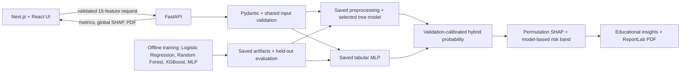

# Explainable AI Engine for Early Cardiovascular Disease Risk Detection

An academic/research application for transparent 10-year coronary heart disease (CHD) risk assessment. The production-style web interface is built with Next.js, React, and TypeScript; FastAPI serves the existing trained hybrid ML/DL pipeline and SHAP explanations.

> **Medical disclaimer:** Educational and research prototype only. This assessment is not a medical diagnosis and should not replace advice from a qualified healthcare professional. Risk categories are model-based, configurable, and not clinically validated. SHAP values describe model contributions and do not prove causation.

## Current data and model status

The source dataset is kept locally under `data/raw` and generated model artifacts under `models`; neither is committed to Git. Run the training command below whenever a fresh checkout has no artifacts. Until successful training completes, the UI displays a model-unavailable state rather than fabricating predictions, metrics, SHAP values, or reports.

## Architecture



## Project structure

```text
frontend/                 Next.js App Router, TypeScript, Tailwind, reusable UI
  app/                    Dashboard, assessment, report analysis, analytics, XAI, risk network, reports, about
  components/             Layout, assessment result, charts, accessible UI primitives
  lib/                    Central API client, schemas, formatting helpers
backend/main.py           FastAPI validation, prediction, performance, SHAP, PDF endpoints
src/                      Existing data, preprocessing, ML, MLP, hybrid, SHAP, PDF and association pipeline
data/raw/                  Place the supplied Framingham CSV here
models/                    Generated trained model artifacts (not committed)
reports/                   Generated dataset audit (not committed)
app.py                     Retained Streamlit compatibility frontend
```

The ordinary assessment flow remains session-only. An optional **local synthetic-data patient-management demo** adds an encrypted SQLite record store, cookie sessions, staff roles, patient linking, report review/release, and a released-report-only portal. This is a single-machine research demonstration, not a clinic record system, and is not certified for real patient information or regulatory compliance. Use synthetic data only. Review [`docs/patient-portal-audit-and-plan.md`](docs/patient-portal-audit-and-plan.md) for exact limitations and setup.

## Requirements

- Node.js 20.9 or newer and npm
- Python 3.11 or newer
- The supplied dataset, with all 15 predictors and the `TenYearCHD` target

## Install and train the model

From the repository root, in PowerShell:

```powershell
python -m venv .venv
.venv\Scripts\Activate.ps1
python -m pip install --upgrade pip
python -m pip install -r requirements.txt
```

Scanned-image OCR uses the local Tesseract executable through `pytesseract`. Install Tesseract separately from a trusted OS/vendor package source to enable OCR; text PDFs and CSV/XLSX reports do not require the executable. If it is unavailable, scanned files return a clear setup error. No vision LLM or external report-processing service is used.

Place the existing dataset at `data/raw/framingham.csv`, then train outside the web request:

```powershell
python -m src.train --data data/raw/framingham.csv
```

Training cleans and audits the input, removes duplicates, handles invalid and missing values, stratifies train and held-out partitions, and fits encoding, imputation, scaling, and class balancing only inside training folds. Logistic Regression, Random Forest, and XGBoost are compared; a tabular scikit-learn MLP is trained with training-only oversampling; the tree branch and hybrid alpha are selected with training-only validation. Final metrics are computed on the held-out split. Training produces the hybrid/model bundles, preprocessing artifacts, metadata, SHAP configuration, and `reports/dataset_report.json`.

The dataset file and model artifacts are excluded from Git. Only use trusted model files with joblib.

## Current local training run

The available source file contains 4,240 rows (the commonly distributed Framingham dataset uses `male` for the gender column; training maps it to the application's `gender` feature). Cleaning retained 4,240 rows and found class counts of 3,596 without the target event and 644 with it. On the stratified 20% held-out split, the recorded results are:

| Model | Accuracy | Precision | Recall | F1 | ROC-AUC |
| --- | ---: | ---: | ---: | ---: | ---: |
| Logistic Regression | 0.672 | 0.254 | 0.597 | 0.356 | 0.701 |
| Random Forest | 0.835 | 0.400 | 0.171 | 0.239 | 0.660 |
| XGBoost | 0.680 | 0.235 | 0.488 | 0.317 | 0.659 |
| Deep Neural Network | 0.767 | 0.220 | 0.209 | 0.214 | 0.587 |
| Hybrid AI | 0.680 | 0.235 | 0.488 | 0.317 | 0.659 |

These are retrospective results from this local dataset and split, not clinically validated performance. The table is generated from the saved model metadata and should be regenerated after retraining.

## Run the application

Start FastAPI from the repository root:

```powershell
.venv\Scripts\Activate.ps1
uvicorn backend.main:app --reload --host 127.0.0.1 --port 8000
```

The API docs are at `http://localhost:8000/docs`. Start Next.js in a second terminal:

```powershell
cd frontend
Copy-Item .env.local.example .env.local
npm install
npm run dev
```

Open `http://localhost:3000`. `frontend/.env.local` uses `NEXT_PUBLIC_API_URL=http://localhost:8000`; change it if FastAPI uses another local address. The FastAPI CORS allowlist defaults to the local Next.js origins and can be changed with `XAI_CVD_CORS_ORIGINS` (comma-separated origins).

Production frontend commands:

```powershell
cd frontend
npm run build
npm run start
```

## API

- `GET /health` — service state and whether the trained model is ready; no local file paths are returned.
- `POST /predict` — validates all 15 fields, returns ML, MLP, and hybrid probabilities, model-based category, consensus, SHAP factors, and general decision-support insights. Each response includes an opaque `assessment_id`, assessment timestamp, and model version.
- `GET /model-performance` — real saved held-out metrics and model selection metadata.
- `GET /xai/global` — global SHAP feature importance plus aggregated contribution quantiles (no training-row values are sent to the browser).
- `GET /dataset-audit` — safe summary of the generated dataset report when available.
- `GET /risk-factor-network` — cached node statistics and statistically supported associations among the 15 predictors. It uses the same cleaned local CSV, excludes `TenYearCHD`, uses pairwise Spearman correlations, requires at least 100 complete pairs, and applies Benjamini–Hochberg correction at q ≤ 0.05. If the source dataset is unavailable or invalid, the endpoint returns an error instead of substitute data.
- `POST /generate-assessment-report` — accepts `{ "assessment_id": "<id returned by /predict>" }` and builds a PDF from that exact in-memory prediction, its SHAP values, inputs, and model metadata. It returns HTTP 410 when the one-hour temporary record has expired, and does not silently rerun inference.
- `POST /generate-report` — compatibility endpoint that performs a new assessment and returns a PDF generated from actual model outputs.
- `POST /api/reports/upload` — accepts a PDF, JPG, PNG, CSV or XLSX file (max 10 MB), returns HTTP 202 and an in-memory extraction job ID.
- `GET /api/reports/{analysis_id}` — reports extraction progress or returns proposed values with confidence, source snippet, page and validation status. Job data expires after 30 minutes.

FastAPI rejects missing, extra, non-finite, out-of-range, and invalid categorical values. Model absence returns a service-unavailable response; API errors are surfaced in the UI. Sensitive patient values are not logged by application code.

Prediction/report matching uses a process-memory cache keyed by random assessment IDs. The cache expires after one hour, is not persisted, and is cleared when the backend restarts. Patient inputs are not placed in the ID or URL. If the cached assessment or its SHAP explanation is missing, the matching PDF request returns an explicit error rather than attaching a different prediction or omitting the graph.

Report uploads are parsed in memory on the local machine; original files are not written to disk or logged. Only extracted candidate values and short source snippets remain temporarily in process memory to support the review step. Restarting the backend discards pending jobs. Every model feature must have a valid user-confirmed value before `/predict` is called; the report path does not silently impute. Reports/FHIR JSON are not part of this first upload flow.

Run synthetic extraction and API tests with:

```powershell
python -m unittest discover -s tests -v
```

## Frontend pages

- **Dashboard:** hybrid overview, architecture, dataset/model readiness and seven-stage workflow.
- **Risk assessment:** five-step form, live review, actual API prediction, consensus, SHAP contributions, an interactive patient-specific contribution graph, and general educational suggestions.
- **Report analysis:** local PDF/image/CSV/XLSX upload, extraction progress, per-field confidence/provenance, editable review, explicit confirmation, and the same live assessment output.
- **Hybrid AI:** interactive explanation of model branches and validation-calibrated blending.
- **Model analytics:** held-out comparison, ROC curves, confusion matrix, global SHAP and data class distribution when artifacts exist.
- **Explainability:** global model importance and in-memory patient-specific SHAP contributions.
- **Risk Factor Network:** interactive dataset-level graph with predictor-category, search, strength, direction, strongest-12, edge-label, zoom/pan, fit-to-screen and node-detail controls. Relationship details show the source and target, signed Spearman coefficient, pairwise sample size, raw p-value and Benjamini–Hochberg-adjusted q-value. The p-value is SciPy's asymptotic Spearman approximation; rows with missing values are omitted separately for each pair, and pairs need at least 100 complete observations. FDR correction is applied across every eligible tested pair at q ≤ 0.05. Descriptive strength bands are labeled as conventions, not clinical cutoffs. Edges describe dataset association, not causation or individual model contributions. NetworkX is used for graph construction when installed; the API retains a dependency-light edge-list fallback for offline environments. The frontend renders an accessible React SVG and adds no graph library dependency.
- **Reports:** select a session assessment and inspect its matching interactive graph, then generate, preview, and download its ReportLab PDF. The PDF embeds a standalone Matplotlib graph generated from the same ordered top-eight patient-specific SHAP values used in the browser. Contributions are on the hybrid model probability scale and use finite-evaluation permutation SHAP, so they are approximate; signed links show model output direction, not statistical association or medical causation. Reports are not a persistent archive.
- **About:** methods, privacy, scope, and limitations.

## Local patient-management demo (synthetic data only)

Patient identity records and report PDFs are encrypted with an operator-supplied Fernet key. SQLite is used as a local, single-process store; passwords use scrypt hashes; report access is role checked on the backend. Portal invite codes are single-use and expire after 24 hours. They are displayed once for staff to deliver manually after checking identity in person. The application sends no email or SMS. Reports are visible to a patient only after clinician review and explicit release (review requirement defaults to on).

In PowerShell from the repository root:

```powershell
$env:XAI_CVD_ENCRYPTION_KEY = (python -m backend.patient_admin generate-key | Select-Object -First 1)
python -m backend.patient_admin create-staff --username demo-clinician --role clinician
```

Keep the printed key in a private local secret store. Losing it makes the encrypted demo records unrecoverable. For a fresh terminal, set the same key again before starting services. Optional `XAI_CVD_PATIENT_DB` selects a different SQLite file; default is `data/patient-demo.sqlite3`, ignored by Git. Set `XAI_CVD_REPORT_REVIEW_REQUIRED=false` only for a controlled demo that intentionally allows generated reports to be released without review; the default is `true`.

Start the API and UI in separate terminals:

```powershell
uvicorn backend.main:app --host 127.0.0.1 --port 8000
cd frontend
npm run dev
```

Open `http://localhost:3000/login` for staff. Register synthetic patients under **Patients**, start a linked assessment, generate its PDF, and use **Clinical review** with a clinician/admin account to review and release it. Issue a portal code from the patient's page and give it to the synthetic demo user manually. They activate at `/portal/activate` and sign in at `/portal/login`.

These local controls do not provide TLS, multi-clinic isolation, MFA, managed key rotation, robust encrypted backups/recovery, automated account recovery, or a deployment-grade rate limiter. Local SQLite encryption protects selected data fields/files, not the whole database/WAL, host, backups, or runtime memory. CORS and CSRF defenses are local-app safeguards, not a substitute for a production identity provider and security review. Do not use real patient data or expose this demo to a public/untrusted network. A private LAN connection is documented only for synthetic Expo testing.

## Patient mobile app (Expo Go)

The separate React Native application is in `mobile/`. It uses the same authenticated backend and patient records. Setup, LAN IP configuration, Expo Go steps, and a narrowly-scoped Windows Firewall example are in [docs/patient-mobile-expo.md](docs/patient-mobile-expo.md). The mobile app is also synthetic-demo-only and does not send configured email/SMS notification preferences.

## Interpretation and limitations

`TenYearCHD` represents the dataset target, not an independently validated clinical risk calculator. The binary prediction threshold and probability bands are model configuration choices. A probability must not be treated as a diagnosis, and changing an input must not be represented as a guaranteed way to prevent disease. Model performance is retrospective and requires external validation before any clinical use.

## Legacy UI

The original Streamlit interface remains available for compatibility:

```powershell
streamlit run app.py
```

Both frontends use the same saved Python artifacts and prediction/report implementation; training is never run during a web request.
# Frontend style guide

The interface tokens, accessibility conventions, component guidance, and current API limitations are documented in [docs/design-system.md](docs/design-system.md).
